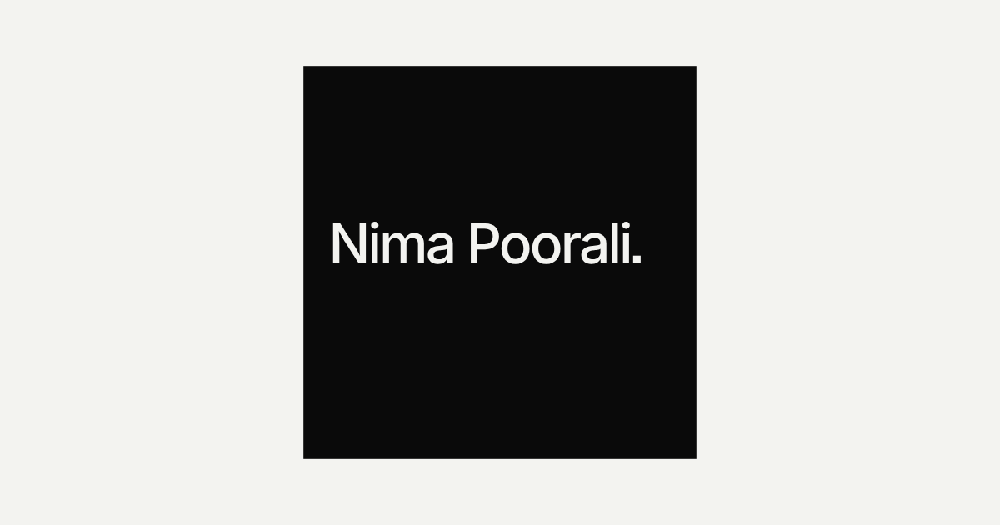

# poorali.dev

One page. One file. No build, no dependencies, no network requests.

**Eleven years drawn as a single unbroken line.** One revolution per year,
spiralling outward from July 2015, with three more rings drawn past the
present — the years being built toward, drawn but not yet lived.



## Run it

```bash
open index.html
```

## What it is

A tree-ring section of a career. The line starts at the origin in Jul 2015 and
turns once per year, its radius growing linearly with time, so every revolution
is exactly one year and the ring spacing is even.

What makes each ring look different is the work being done that year. For every
sample along the line, the engagements active on that date each contribute a
sine wave at their own frequency and amplitude:

| Years | Engagement | Weight | Freq |
|---|---|---|---|
| Jul 2015 – Sep 2017 | Dariche Zehn — Frontend Developer | 0.55 | 3 |
| Sep 2017 – Jun 2021 | Karaweb — Full Stack Developer | 0.78 | 5 |
| Jan 2021 – Jun 2025 | Upwork — Freelance, 100% success | 0.62 | 9 |
| Jan 2022 – Dec 2023 | QuadVentures — Lead Web Developer | 0.98 | 4 |
| Dec 2023 – Jul 2025 | Aligned Voyage — Co-founder | 1.00 | 6 |
| Jul 2025 – now | German B2B SaaS — Frontend Consultant, design systems | 1.00 | 2 |

**Overlaps are the interesting part.** Where two engagements run concurrently
their frequencies beat against each other, and the rings for those years are
visibly more agitated than the years with a single focus. Every start and end
date also leaves a scar — a brief radial spike, the way a hard winter shows in
real wood.

Month boundaries are inferred where only years were known. Correct them in the
`WORK` array and the drawing changes accordingly.

## Why "1 path · 0 lifts" is true

The whole ring structure is a single `beginPath()`, one `moveTo`, ~8,600
`lineTo`, one `stroke()`. The pen is never lifted.

Colour still varies along the line — quiet in the early years, accent through
the current year, faint for the years ahead — because that is done with a
**radial gradient as the stroke style**, not by starting a new path. Since the
radius grows linearly with time, gradient position and elapsed time are the
same number, so a colour stop at `t` lands exactly on the ring for that date.

The accent band has to span a full revolution. Any narrower and the ring's own
wobble carries it in and out of the band, which shows up as orange flecks
instead of a continuous glowing ring.

`lifts` is measured — it counts `moveTo` calls minus the initial placement of
the pen — rather than hardcoded.

## The only input is time

There is no `Math.random()` anywhere in the file. Every value derives from a
date: the wobble from the engagement dates, the wood grain from a hash of the
day index. Consequences:

- The drawing is identical for every visitor, on every machine.
- It is **one day longer tomorrow.** The composition genuinely grows.
- The accent marks today, so the bright ring moves outward over time.

## Hover

The rings are the CV. Moving across them maps radius back to a date and prints
what was happening then — `Mar 2023 · QuadVentures Lead Web Developer +
Upwork Freelance`. There is no other navigation, and no other copy.

## Reduced motion

`prefers-reduced-motion` skips the 7-second draw-on and renders the completed
line immediately. Everything else, including hover, still works.

This is also how to screenshot the finished state, since headless Chrome
throttles `requestAnimationFrame` and would otherwise capture the drawing
part-way through:

```bash
"/Applications/Google Chrome.app/Contents/MacOS/Google Chrome" --headless=new --force-prefers-reduced-motion --window-size=1600,1000 --screenshot=out.png "file://$PWD/index.html"
```

## Continuity with the brand

Same dark palette as `../brand` — background `#0B0D10`, line `201,207,216`,
accent `255,95,61` — so the site and the LinkedIn banners read as one system.

## Deploying

One static file, zero dependencies. Cloudflare Pages, Netlify, GitHub Pages or
a plain bucket all work.

**Live at https://poorali.dev** since 2026-08-01. `index.html` and `og.png` are
uploaded as-is — there is no build step, so deploying a change is copying the
file. HTTP redirects to HTTPS and `www` resolves.

> **`.dev` is on the browser HSTS preload list.** There is no `http://` fallback: without
> a valid certificate for the domain the site is unreachable in *every* browser, even
> while `curl http://` happily returns 200. If it looks fine to curl and blank to humans,
> that's the cert. Diagnose with:
>
> ```bash
> openssl s_client -connect poorali.dev:443 -servername poorali.dev </dev/null
> ```
>
> A missing per-domain cert shows up as TLS alert 80 / "no peer certificate available",
> while a shared host keeps serving its own wildcard cert instead.
